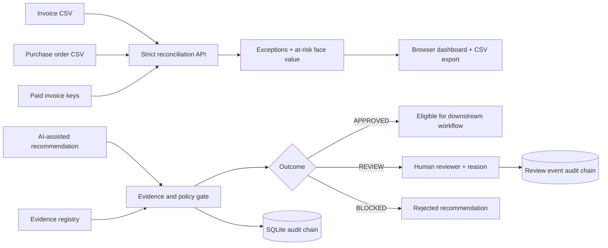

# Proofline — AI Decision Assurance & Accounts Payable Exception Intelligence

**A working, test-backed application for evaluating AI-assisted financial decisions and reconciling invoices against purchase orders.**

Proofline solves two connected business problems:

1. **Unreliable automated recommendations.** An AI assistant or business workflow can propose paying an invoice, but should not be authorized to act without verifiable evidence, policy checks, privacy checks, and a review trail.
2. **Accounts payable exceptions.** Finance teams need to identify duplicate invoices, missing purchase orders, vendor mismatches, amount differences, currency mismatches, and already-paid invoices before disbursement.

The product intentionally **does not execute payments**. A matched invoice means the supplied records reconcile, **not** that the source documents are authentic. The app produces useful operational insights, not invented claims of realized savings or detected fraud.

## Start the application

Requires Python 3.12+.

```bash
python -m venv .venv
# Linux/macOS: source .venv/bin/activate
# Windows PowerShell: .venv\Scripts\Activate.ps1
pip install -r requirements.txt
```

Set environment variables (never commit real credentials):

```bash
export PROOFLINE_API_KEY='a-long-random-secret'
export PROOFLINE_TENANT='default'
export PROOFLINE_DEMO=1
export PROOFLINE_DB='./proofline.db'
uvicorn proofline.api:app --host 127.0.0.1 --port 8000
```

On Windows PowerShell use `$env:PROOFLINE_API_KEY="..."` etc. Visit **http://127.0.0.1:8000**. Click **Run synthetic assurance suite** for six policy examples, then **Load sample dataset** and **Analyze invoices** to see a working reconciliation, root-cause exceptions, and downloadable findings. Upload your own CSVs to the private workflow by entering the matching tenant and Bearer key. The files are not stored by the reconciliation endpoint.

Run the tests:

```bash
python -m pytest -q
```

## Real functionality

| Area | What works | What it proves |
| --- | --- | --- |
| Decision policy | Evidence existence, age and status; amount thresholds; duplicate vendor/invoice IDs; PII checks; rationale checks | Rule-based authorization and explainability |
| Accounts payable | Invoice-to-PO joins; amount tolerance; vendor, currency and paid-reference checks; duplicate-in-batch detection | Deterministic financial data reconciliation |
| Business intelligence | Exception rate, count, flagged face value, frequent rule failures and recommended follow-up actions | Actionable descriptive analysis |
| Human-in-the-loop | Approve/reject only `REVIEW` outcomes; mandatory reviewer justification; no override of `BLOCKED` | Human decision controls |
| Audit | Append-only-by-application assessment and review event hash chains; verification endpoints | Tamper-evident event history (not tamper-proof) |
| API security | Per-tenant Bearer key mapping; no caller-controlled cross-tenant access; strict Pydantic validation | Baseline tenant isolation |
| Frontend | Interactive dashboard, CSV upload, sample data, exception table, export, assurance insights | End-to-end usability |
| Tests | API, auth, policy, reconciliation, insights, review, audit, ERP adapter mocking and cryptographic tamper tests | Repeatable functional checks |
| ERP connectors | Read-only Xero, QuickBooks Online Bill and Business Central adapters | Provider-field normalization, controlled pagination and provenance when configured |
| Signed invoice verification | Detached Ed25519 checks, trusted key pinning and signed JSON evidence registration | Byte integrity and origin relative to configured key, not legal authenticity |

### Architecture



**No LLM is required.** Proofline is the independent control layer around AI-assisted decisions; its assessments are deterministic and reproducible. A real LLM, OCR engine, native PDF-signature validator, and payment system are not part of this project. Read-only ERP connectors exist, but require independently authorized credentials to connect to an actual company.

## CSV formats

Invoices: `invoice_id,vendor_id,po_id,amount,currency,invoice_date`.

Purchase orders: `po_id,vendor_id,amount,currency`.

See [`examples/invoices.csv`](examples/invoices.csv) and [`examples/purchase_orders.csv`](examples/purchase_orders.csv). The browser parses CSV with quoted fields and limits uploads to 1 MB per file. API request bodies limit each list to 1,000 records. Currency must be a three-letter uppercase ISO-style code; **no FX conversion** is performed. Purchase orders must have unique IDs.

A flagged invoice's full amount contributes to `at_risk_amount`, including duplicate records. This is **exposure under review**, not fraud loss or savings. Multiple exception reasons can attach to one invoice.

## API

All operational endpoints require `Authorization: Bearer <key>` and `X-Tenant-ID: <tenant>`. Configure `PROOFLINE_TENANT_KEYS='{"acme":"key-for-acme","beta":"key-for-beta"}'` for explicit per-tenant mapping. The simpler `PROOFLINE_API_KEY` is scoped only to `PROOFLINE_TENANT` (default `default`). A key for one tenant cannot access another tenant's data.

| Method | Endpoint | Function |
| --- | --- | --- |
| GET | `/health` | HTTP liveness, not financial data quality |
| GET | `/demo` | Six synthetic decision examples; only when demo enabled |
| GET | `/demo/insights` | Synthetic descriptive assurance insights |
| POST | `/demo/reconcile` | Stateless synthetic-demo reconciliation, when demo enabled |
| POST | `/v1/reconcile` | Protected, stateless invoice/PO reconciliation |
| POST | `/v1/evidence` | Store tenant-scoped evidence metadata |
| POST | `/v1/assess` | Evaluate decision and append audit entry; idempotent per decision ID |
| GET | `/v1/assessments` | Tenant-scoped policy results |
| GET | `/v1/insights` | Operational findings and actionable follow-ups |
| GET | `/v1/audit/verify` | Assessment hash-chain check |
| POST | `/v1/reviews` | Record justified human disposition for `REVIEW` cases |
| GET | `/v1/reviews` | Review records |
| GET | `/v1/reviews/audit/verify` | Review event hash-chain check |

See [`docs/api.md`](docs/api.md) for request examples and [`docs/assurance.md`](docs/assurance.md) for trust boundaries.

## Deployment and security boundaries

- The Dockerfile runs as a non-root user. The default SQLite database path is `/tmp/proofline.db`, **ephemeral** in a container; mount persistent storage for operational use. SQLite is suitable for this single-instance application, **not** a multi-replica enterprise deployment.
- Disable the synthetic demo in production with `PROOFLINE_DEMO=0`. The protected reconciliation endpoint is stateless, but the request still traverses the hosting provider's infrastructure. Use TLS and an approved data processing environment for private financial data.
- Evidence metadata is caller-submitted. A `verified` flag is **not independent verification**. Only a trusted ingestion service should set it in a production integration. Read-only ERP adapters and trusted Ed25519 detached signature checks are implemented, but there is no integrated identity provider, automatic OAuth onboarding, native PDF PKI validation, SOC 2 certification, or externally anchored immutable ledger.
- The browser does not save Bearer tokens to local storage. Avoid shared/public devices and clear credentials after use.
- Review decisions do not release funds. Assessment approvals only mean configured rules passed.
- Hash chaining detects ordinary record edits but cannot prevent a privileged database administrator from rewriting an entire chain; external anchoring would be required for stronger assurances.

## Project structure

```text
proofline/
  core.py             Policy evaluation, PII redaction and scoring
  reconcile.py        Invoice/PO reconciliation
  insights.py         Descriptive risk intelligence
  review.py           Human dispositions and review audit
  store.py            SQLite evidence, decisions, audit ledger
  api.py              FastAPI endpoints and tenant-bound authentication
  demo.py             Synthetic cases, no real records
  dashboard.html      Browser UI, CSV upload and export
examples/              Sample invoices and purchase orders
docs/                  API, assurance and architecture notes
tests/                 Automated regression and security tests
.github/workflows/     CI test workflow
Dockerfile             Non-root container image
```

## Known boundaries and roadmap

Proofline is a complete **bounded workflow** for structured invoice/PO reconciliation and policy assessment, not a complete enterprise accounts-payable platform. Its production gaps are documented, not hidden: automated ERP OAuth onboarding and refresh, native PDF PKI signature validation, role-based identity, SSO, encrypted storage, enterprise-grade event immutability, deployment to a verified production host, performance/load testing, and calibrated detection metrics on real labeled data. The demo is synthetic; actual business impact must be measured on permissioned operational datasets.

**Author:** Zachary Amachee · **License:** MIT · **Purpose:** Demonstrate AI engineering, data engineering, backend APIs, cybersecurity controls, and actionable financial analytics.

### Example analytical output

The bundled four-invoice synthetic dataset produces **two matched invoices and two exceptions**. The flagged invoice face value is **$10,600**; this includes a repeated invoice and must not be presented as a verified loss. The specific exception reasons are available in [`examples/example_results.json`](examples/example_results.json). These are reproducible demonstration results, not findings from a real company.

## v0.3 — ERP integrations, signed invoice evidence and larger-scale analytics

**Three server-authenticated, read-only ERP connectors** are implemented: Xero (`ACCPAY` bills), QuickBooks Online (`Bill` records), and Microsoft Dynamics 365 Business Central (`purchaseInvoices`). The adapters use OAuth2 **access tokens already issued by the provider** and placed in server-side environment configuration. The connectors have automated tests against recorded-shape HTTP mock responses, **not proof of a live customer ERP connection**. No ERP payment execution, create/update/delete operations, or OAuth consent UI is implemented. See [ERP setup and limitations](docs/integrations.md).

**Detached Ed25519 document verification** checks actual file bytes against a SHA-256 checksum and an independently configured trusted public signing key. A signed, structured JSON invoice can be registered atomically as verified evidence for the policy engine. The project does **not** independently validate native PDF signatures, identity/KYC, invoice issuance legitimacy, bank-account ownership, or underlying commercial claims. See [document trust](docs/document-trust.md).

**Larger realistic-scale synthetic fixtures:** `examples/generate_large_dataset.py` deterministically generates **500 invoices and 500 purchase orders**, including duplicate identifiers, amount deviations, vendor mismatches, missing POs and currency mismatches. The browser's **Load 500-invoice synthetic dataset** button uses the demo endpoint (enabled only with `PROOFLINE_DEMO=1`). The generated CSV files live at `examples/invoices_large.csv` and `examples/purchase_orders_large.csv`. The summary now reports top exception causes, top vendors, and flagged invoice face value **by currency**. It does not perform FX conversion or claim savings/fraud.

Additional endpoints:

| Method | Endpoint | Purpose |
| --- | --- | --- |
| `POST` | `/v1/erp/reconcile` | Read configured Xero/QBO/Business Central AP data and run reconciliation |
| `POST` | `/v1/documents/verify` | Independently verify SHA-256 and detached Ed25519 signature using server-trusted key |
| `POST` | `/v1/documents/attest` | Atomically register a valid signed JSON invoice as tenant-bound verified evidence |
| `GET` | `/demo/dataset` | Return 500 fully synthetic invoices and POs when demo mode is enabled |

These changes **expand the prototype**, but do not constitute a certification-ready production finance system. Production rollout would still require credential onboarding and refresh, live authorized ERP sandbox testing, robust monitoring, independent control testing, stronger identity/RBAC and persistent infrastructure. No invoice payments are authorized or executed.
